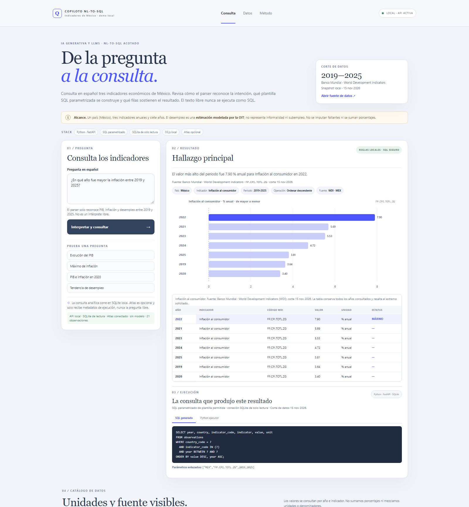

# NL-to-SQL Economic Copilot

**Copiloto que responde preguntas en lenguaje natural sobre indicadores
económicos de México** traduciéndolas a SQL parametrizado sobre un snapshot
público. La traducción es determinista por omisión, la base se abre en solo
lectura y ninguna pregunta se convierte en SQL libre.

[](https://github.com/Dev-HugoAguilar/nl2sql-economic-copilot/actions/workflows/tests.yml)
[](https://www.python.org/)
[](src/app/nl_sql/service.py)

> **Alcance.** Un solo país (México), tres indicadores y siete años. El parser
> local reconoce un vocabulario acotado; fuera de él, el copiloto rechaza la
> pregunta en lugar de improvisar. El proveedor de modelos es opcional y solo
> puede producir un plan JSON que se valida antes de tocar la base.

---

## Qué demuestra

- **Traducción sin superficie de inyección**: el SQL se arma con una plantilla a
  partir de un plan validado; el texto de la pregunta nunca se concatena en la
  consulta. `PIB 2020; DROP TABLE observations; --` se resuelve como una pregunta
  normal y la tabla sigue intacta.
- **Solo lectura real**: la conexión de consulta rechaza cualquier sentencia que
  no sea `SELECT` y la base derivada se abre en modo `mode=ro`.
- **Rechazo explícito**: país distinto de México, años fuera de 2019–2025 o
  peticiones incompatibles producen errores con mensaje, no resultados vacíos.
- **Auditoría sin preguntas**: si la auditoría en MongoDB está habilitada, guarda
  los indicadores, el modo y el conteo de filas — **nunca** el texto de la
  pregunta.
- **Diagnóstico sin secretos**: `/health` informa capacidades y objetivo
  (`local` / `atlas`) sin serializar la URI ni la clave.

## Demo

```bash
git clone https://github.com/Dev-HugoAguilar/nl2sql-economic-copilot.git
cd nl2sql-economic-copilot
python -m http.server 8000 --directory web
```

Abre <http://127.0.0.1:8000/>. La interfaz funciona solo con `web/data.json`; no
requiere el servicio de dominio.



Preguntas que el parser local resuelve:

- *¿En qué año fue mayor la inflación entre 2019 y 2025?*
- *Compara PIB e inflación durante 2020.*
- *¿En qué año fue menor el crecimiento del PIB?*

## Servicio de dominio

```bash
python -m pip install -r requirements-dev.txt
python -m pytest
```

Once pruebas cubren la carga del snapshot, el ranking descendente y ascendente, la
comparación de un año, los cuatro errores de parser, el intento de inyección, el
rechazo de escrituras, el plan del modelo válido, el plan inválido que degrada al
parser local y la auditoría que no guarda la pregunta.

### Uso directo

```python
from app.config import Settings
from app.nl_sql.service import CopilotoNlSql

copiloto = CopilotoNlSql(db=None, settings=Settings())
salida = copiloto.consultar("¿En qué año fue mayor la inflación entre 2019 y 2025?")

print(salida["spec"]["kind"])        # ranking
print(salida["sql"])                 # SELECT ... WHERE ... ORDER BY value DESC
print(salida["parameters"])          # ['MEX', 'FP.CPI.TOTL.ZG', 2019, 2025]
print(salida["rows"][0]["year"])     # 2022
```

## Cómo funciona

```text
pregunta
   │
   ├─ (opcional) proveedor de modelos → plan JSON → validación estricta
   │                                    └─ inválido → se descarta
   └─ parser local léxico + plantillas → plan validado
                                            │
                     plantilla SQL + parámetros (sin concatenación)
                                            │
                            SQLite en modo solo lectura
                                            │
                             filas, resumen y trazabilidad
```

| Modo | `intent_mode` | Cuándo aparece |
|---|---|---|
| Reglas | `reglas-locales` | El parser reconoce país, indicador(es), años y operación. |
| Modelo | `llm-json-validado` | El proveedor devuelve un plan que pasa todas las validaciones. |

Un plan del modelo se descarta si propone un código de indicador inexistente, un
país distinto, años fuera de rango o más de los indicadores permitidos para la
operación. En ese caso el flujo continúa con el parser local.

## Estructura

```text
web/                        Aplicación estática (sin compilación)
  index.html                Consulta, SQL generado, tabla y resumen
  app.js                    Interfaz y lectura del snapshot
  data.json                 Snapshot WDI · 21 observaciones
  vendor/d3.min.js          D3 v7.9.2 (ISC), servido localmente
src/app/config.py           Configuración sin secretos ni rutas absolutas
src/app/nl_sql/service.py   Parser, plan, plantilla SQL, ejecución y auditoría
tests/test_service.py       Once pruebas con sqlite3 real y base falsa
pipeline/refresh_worldbank.py  Descarga reproducible del snapshot
docs/ARCHITECTURE.md        Flujo, validaciones y contrato HTTP
docs/DATA.md                Fuente, licencia y límites
```

La capa HTTP se publica por separado, en el repositorio de infraestructura
`portfolio-api`. Rutas previstas: `GET /api/v1/copiloto-nl-sql/health`,
`GET …/datos` y `GET …/query?question=…`.

## Límites

- Un país, tres indicadores, siete años: no es un copiloto económico general.
- El parser local es léxico: no comprende paráfrasis fuera de su vocabulario.
- El resumen es una plantilla sobre las filas devueltas; no interpreta causalidad.
- Las cifras provienen de un snapshot; no se actualizan solas.
- La auditoría y el modelo dependen del entorno local y son opcionales.

## Datos y atribución

World Development Indicators (Banco Mundial), México, 2019–2025, bajo
**CC BY 4.0**. Códigos `NY.GDP.MKTP.KD.ZG`, `FP.CPI.TOTL.ZG` y `SL.UEM.TOTL.ZS`.
Detalle en [`docs/DATA.md`](docs/DATA.md). Este repositorio no incluye un archivo
`LICENSE` propio: se respetan las condiciones de la fuente citada.

## Contribuir y seguridad

Convenciones en [`CONTRIBUTING.md`](CONTRIBUTING.md). Para reportar un problema de
seguridad, usa los avisos privados de [`SECURITY.md`](SECURITY.md).
